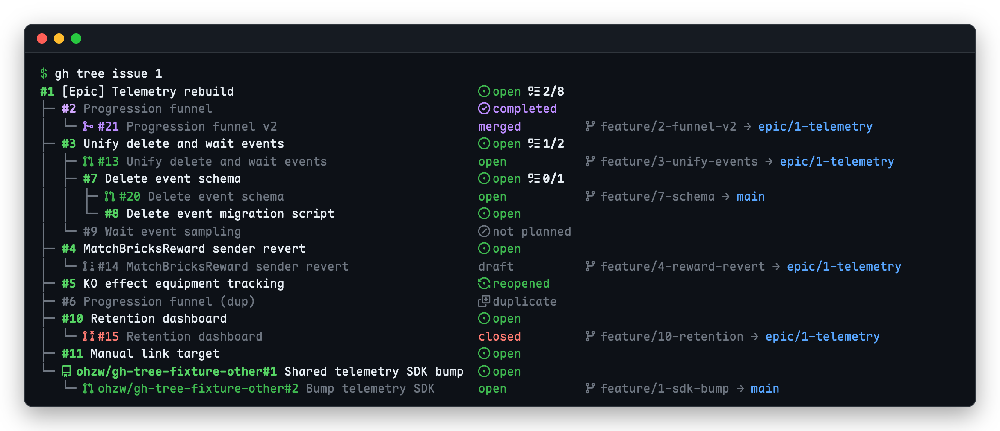
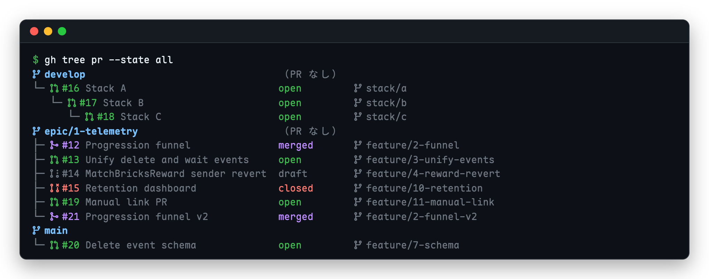
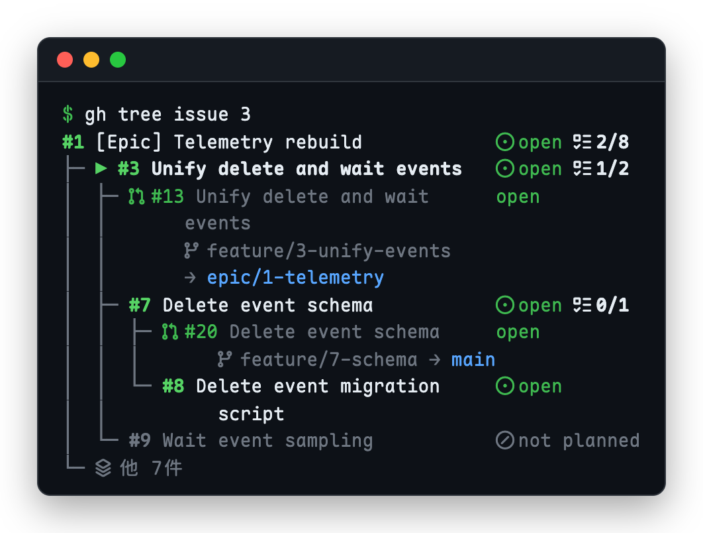

# gh-tree

[English](README.md) | 日本語

GitHub の Issue・PR・branch の関係（Sub-issue の親子、Issue に紐づいた PR、PR の merge 先のつながり）と、それぞれの状態をターミナルに tree で表示する [gh](https://cli.github.com/) の extension です。リポジトリのファイル構成の tree を表示するツールではありません。npm の同名パッケージ gh-tree（[mgks/GitHubTree](https://github.com/mgks/GitHubTree)）とは無関係です。



## インストール

```sh
gh extension install ohzw/gh-tree
```

## 使い方

```
gh tree issue <number>... [flags]   Issue tree（Sub-issue と、各 Issue に紐づいた PR）
gh tree pr [<number>...] [flags]     PR tree（番号を省けば、対象の状態の PR すべて）
gh tree branch <name> [flags]        指定した branch を根にした PR tree
gh tree <number>                     番号から Issue か PR かを自動で判定する
gh tree                              ヘルプを表示する
```

| フラグ | 対象 | 内容 |
|---|---|---|
| `--json` | 共通 | JSON で出力する |
| `--no-color` | 共通 | 色を付けない（`NO_COLOR` 環境変数にも従う） |
| `-d, --depth N` | 共通 | たどる深さ。根を 0 と数える（既定: 無制限） |
| `--labels a,b` | 共通 | 節点の横に表示するラベル。絞り込みには使わない |
| `--no-icons` | 共通 | [Nerd Fonts](https://www.nerdfonts.com/) の Octicons をやめ、記号（`●` `✓` `PR` など）で描く。Nerd Font のないターミナルで使う |
| `--hide-closed` | issue | closed の子を1行にまとめる |
| `--no-ancestors` | issue | 指定した Issue の親（祖先）の経路を表示しない |
| `--state open\|merged\|all` | pr / branch | 表示する PR（既定: open） |
| `--issues` | pr / branch | 各 PR に紐づいた Issue を PR の子として表示する |

PR は、base と同じ名前の head を持つ PR の子になります。付け先に PR がない branch は独立した根の節点になり、既定の branch 以外には `（PR なし）` が付きます。親の節点がそのまま base になっている PR（PR tree のほとんどの PR）には head だけを出し、それ以外（Issue tree の PR など）には `head → base` を出します。



Issue に紐づいた PR は、GitHub の Issue の Development 欄と同じものです。GitHub は default branch 以外を base にした PR の `Fixes #N` を紐づけとして扱わないため、Epic branch などに向けた PR を Issue tree に出すには、Web UI の Development 欄で手で紐づけてください。

Issue の状態は、`open`・`reopened`・`completed`・`closed`（理由なし）・`not planned`・`duplicate` と出します。完了数（`1/4`）は状態の横に付けます。

ターミナルに出すときは、Issue と PR の番号とタイトルが GitHub へのリンク（OSC 8）になり、Cmd+クリック（ターミナルによっては Ctrl+クリック）で開けます。対応していないターミナルではただの文字として表示されます。tmux では `set -as terminal-features ",*:hyperlinks"` が要ります。パイプやリダイレクトに出すときはリンクを付けません。

ターミナルの幅に収まらないときも、情報は省かずに行を増やします。まずタイトルを列の中で折り返し、次に PR の `head → base` を PR の下の行に移します。それでも列の幅が足りない節点は、タイトルを幅いっぱいに出し、その下の行に状態と詳細を移します（節点の多くがそうなるときは全節点をこの形にそろえます）。節点の続きの行は子の行より深く字下げするので、子と見分けられます。パイプやリダイレクトに出すときは折り返しません。

Issue に親があるときは、一番上の祖先から指定した Issue（`▶` 付き）までの経路を上に表示します。経路にない子は `他 N件` とまとめます。



既定では状態や PR、branch を Nerd Fonts のアイコンで描きます。次の例は、どの環境でも読めるよう `--no-icons` で出したものです。

```
$ gh tree issue 1244 --no-icons
#1244 [Epic] Telemetryを判断起点で作り直す  ● open 1/4
├─ #1245 Bricks の Progression Funnel       ✓ completed
│  └─ PR #1248 Funnel                       merged       feature/1245 → epic/1244
└─ #1254 削除と待機イベントの一本化         ● open
   └─ PR #1257 Unify delete                 open         feature/1254 → epic/1244

$ gh tree issue 1244 --no-icons        # 幅 40 のターミナル
#1244 [Epic] Telemetryを判   ● open 1/4
│    断起点で作り直す
├─ #1245 Bricks の Progression Funnel
│  │    ✓ completed
│  └─ PR #1248 Funnel        merged
│          feature/1245 → epic/1244
└─ #1254 削除と待機イベントの一本化
   │    ● open
   └─ PR #1257 Unify delete  open
           feature/1254 → epic/1244

$ gh tree pr --no-icons
main
└─ PR #1260 Release 2.4   open         release/2.4
epic/1244                 （PR なし）
└─ PR #1257 Unify delete  open         feature/1254
```

## JSON

`--json` は tree の表示と同じ入れ子の JSON を出します。先頭の `schemaVersion` は、項目の名前や形を変えたときにだけ上がります。項目の定義は [`internal/model/model.go`](internal/model/model.go) の `Document` と `Node` です。

```
$ GH_REPO=cli/cli gh tree pr 9847 --json
{
  "schemaVersion": 1,
  "repo": "cli/cli",
  "roots": [
    {
      "kind": "branch",
      "name": "trunk",
      "children": [
        {
          "kind": "pr",
          "repo": "cli/cli",
          "number": 9847,
          "title": "[gh search issues] Support multiple author options",
          "url": "https://github.com/cli/cli/pull/9847",
          "state": "OPEN",
          "isDraft": true,
          "base": "trunk",
          "head": "shion/9828",
          "headOwner": "Shion1305",
          "children": []
        }
      ]
    }
  ]
}
```

## 必要な権限

`gh` の認証をそのまま使います。必要な scope は `repo` です。足りないときは `gh auth refresh -s repo` で追加します。

## 対象のリポジトリ

カレントディレクトリの git リポジトリが対象です。環境変数 `GH_REPO`（`owner/name`）があればそちらを優先します。`-R` はありません。

```sh
GH_REPO=cli/cli gh tree pr
```

## ライセンス

[MIT](LICENSE)
