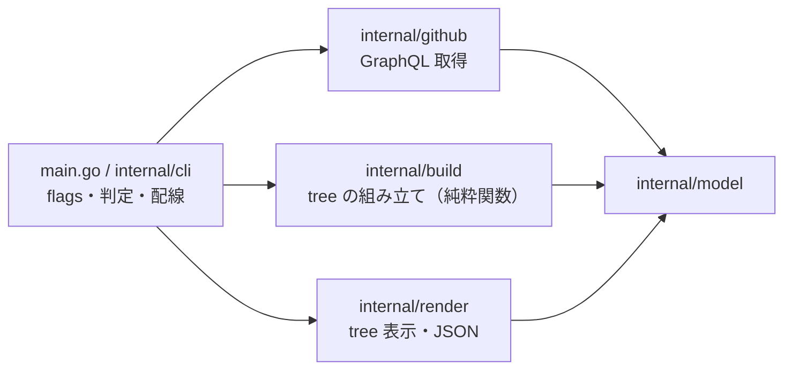

# 実装の構成

PRD（`docs/prd.md`）の「取得・組み立て・表示」の3層を、次のパッケージに分けます。共有する型は `internal/model/model.go` にあります。



## internal/github（取得）
```go
type Client struct{ /* unexported */ }

// repo は "owner/name"。go-gh の api.DefaultGraphQLClient を使う。
func NewClient(repo string) (*Client, error)

// Kind は番号が Issue か PR かを返す（issueOrPullRequest）。どちらでもなければエラー。
func (c *Client) Kind(ctx context.Context, number int) (model.Kind, error)

// IssueTree は根の Issue から depth 段まで Sub-issue をたどる（depth < 0 は無制限）。
// ページ送りはすべて解決済みで返す。
func (c *Client) IssueTree(ctx context.Context, number int, depth int) (*model.Issue, error)

// PullRequests は states（"OPEN" | "MERGED" | "CLOSED"）の PR をすべて返す。
func (c *Client) PullRequests(ctx context.Context, states []string) ([]model.PR, error)

// PullRequest は1件の PR を返す。
func (c *Client) PullRequest(ctx context.Context, number int) (model.PR, error)

// DefaultBranch は既定の branch の名前を返す（defaultBranchRef.name）。空のリポジトリでは ""。
// pr / branch の tree 表示のときだけ、PullRequests と並行して呼ぶ。
func (c *Client) DefaultBranch(ctx context.Context) (string, error)
```

## internal/build（組み立て）
API を呼ばない純粋関数です。PRD 8章の規則はすべてここに置きます。
```go
type Options struct {
	Depth      int      // < 0 は無制限。根を 0 として数える。紐づいた PR / Issue の行も1段
	HideClosed bool     // closed の Sub-issue を親の HiddenClosed に畳む
	WithIssues bool     // PR の子として ClosingIssues を出す（--issues）
	Labels     []string // 節点に残すラベル。空なら Labels は空
}

func IssueTree(root *model.Issue, opt Options) *model.Node
func PRForest(prs []model.PR, opt Options) []*model.Node
// PRFocus は、根の branch から number の PR までの経路と、その PR より下の木を返す。
func PRFocus(prs []model.PR, number int, opt Options) (*model.Node, error)
// BranchTree は branch を根にした PR tree を返す。
func BranchTree(prs []model.PR, branch string, opt Options) (*model.Node, error)
```

## internal/render（表示）
```go
type Options struct {
	Color         bool
	Repo          string // 表示中の "owner/name"。ほかのリポジトリの Issue と PR は owner/repo#N と出す
	DefaultBranch string // この名前の branch の節点には「（PR なし）」を付けない
}

func Text(w io.Writer, roots []*model.Node, opt Options) error
func JSON(w io.Writer, repo string, roots []*model.Node) error
```

## main.go / internal/cli（配線）
cobra でサブコマンドとフラグを定義します。対象のリポジトリは go-gh の `repository.Current()`（`GH_REPO` を優先）で決めます。
